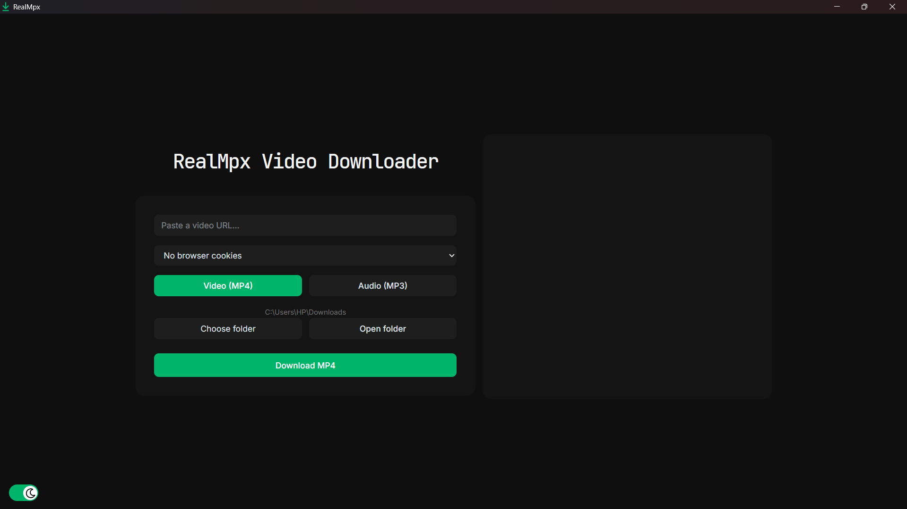
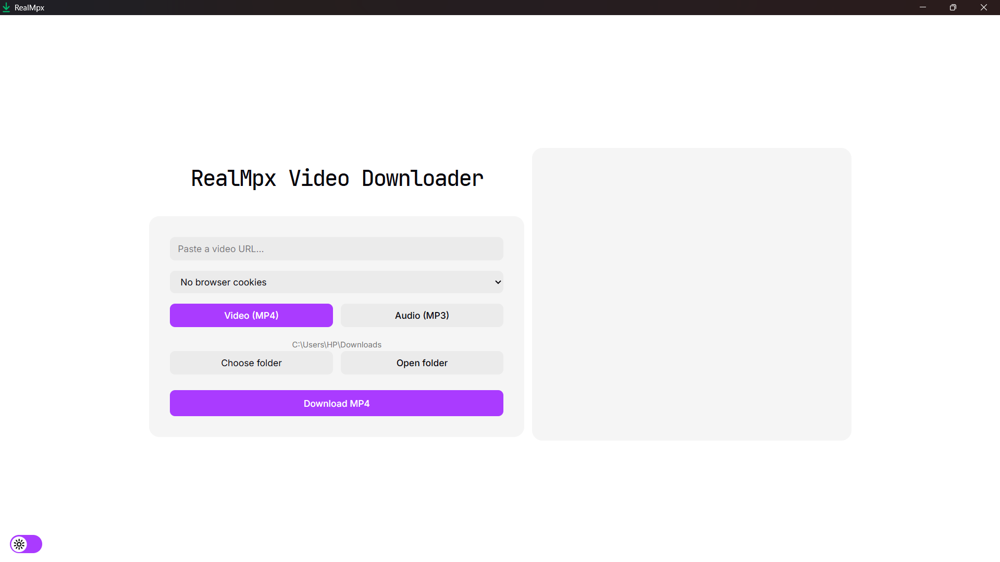

# RealMpx




RealMpx is a desktop media downloader built with Tauri, React, TypeScript, and Rust. It uses yt-dlp to download videos and extract audio.

## Features

- Download videos as MP4.
- Choose video quality from the lowest available to the highest available.
- Extract audio as MP3.
- Choose an output folder.
- Open the output folder from the app.
- View live download logs.
- Pause, resume, or cancel downloads where supported.
- Use a dark or light theme.
- Check that the bundled media tools are available.

## Tools

The app uses these tools:

- yt-dlp for downloading media.
- FFmpeg for merging video and audio and for audio conversion.
- FFprobe for media information.
- Deno for the JavaScript runtime used by yt-dlp.

The tools are loaded from `resources/bin`. The executable files are not included in this repository because some of them are too large for normal GitHub storage. Copy the required files into `resources/bin` before building the app:

```text
yt-dlp.exe
ffmpeg.exe
ffprobe.exe
deno.exe
```

`ffplay.exe` and the Deno package database are not needed.

## Development requirements

Install Node.js, Rust, and the Tauri prerequisites for your operating system.

The bundled tools listed above are also needed to run and build the app.

## Development

```bash
git clone https://github.com/codeyahya/realmpx.git
cd realmpx
npm install
npm run tauri dev
```

## Build

```bash
npm run tauri build
```

The build creates a Windows installer when it is run on Windows.

## Project structure

- `src` contains the React user interface.
- `src-tauri` contains the Rust and Tauri code.
- `resources/bin` contains the media tools used by the app.
